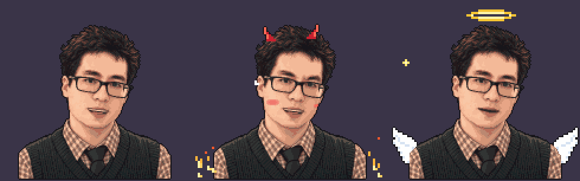

# Pixel Avatar: OBS kurulumu



Webcam yerine kullanılan, konuşunca ağzı oynayan pixel karakter. Gözünü kırpıyor, nefes alır gibi hafifçe iniş çıkış yapıyor, gözlüğünde ara sıra ışık parlıyor. 30 saniye susunca kafasının üstünde "z" harfleri çıkmaya başlıyor.

| Dosya | Ne için |
|---|---|
| `avatar-normal.html` | Normal ders ekranları |
| `avatar-cehennem.html` | RAGE ekranı: boynuz, çatık kaş, kızaran yanaklar, yanlardan alev, bağırınca kulaktan buhar |
| `avatar-cennet.html` | Cennet ekranı: hale, kanat, yıldızlar |
| `ayarlar.js` | Şifre, mikrofon adı, ağız hassasiyeti, boyut |
| `sprite.js` | Karakterin kendisi ve kareleri (silme, avatar bunsuz çalışmaz) |
| `kareler/` | Yedek plan için PNG kareler (aşağıda) |

## 1. OBS'te WebSocket'i aç (bir kere)

Avatar sesi OBS'in kendi mikrofonundan okuyor, bu yüzden tarayıcıya mikrofon izni vermek gerekmiyor.

1. OBS → **Araçlar → WebSocket Sunucu Ayarları**
2. **WebSocket sunucusunu etkinleştir** kutusunu işaretle (port 4455 kalabilir)
3. **Bağlantı Bilgilerini Göster**'e basıp şifreyi kopyala
4. `ayarlar.js` dosyasını Not Defteri ile aç ve şifreyi `sifre: '...'` kısmına yapıştır

## 2. Avatarı sahneye ekle

1. Sahnede **Kaynaklar → + → Tarayıcı**
2. **Yerel dosya** kutusunu işaretle ve `avatar-normal.html` dosyasını seç
3. **Genişlik 480, Yükseklik 459** gir (`olcek: 3` için; ölçek 2 olursa 320×306, 4 olursa 640×612)
4. Webcam'in durduğu yere taşı

Cehennem sahnesine aynı şekilde `avatar-cehennem.html`, Cennet sahnesine `avatar-cennet.html` ekle.

## 3. Ağız hassasiyeti

`ayarlar.js` içinde `ayar_ekrani: true` yap, sonra kaynağa sağ tıklayıp **Özellikler → Mevcut sayfanın önbelleğini yenile**'ye bas. Avatarın altında ses seviyesi ve OBS'teki ses kaynaklarının adları görünecek.

- **Konuşurken ağız az açılıyorsa** `yarim` ve `acik` değerlerini küçült (ör. `-48` / `-36`)
- **Klavye sesinde ya da nefeste bile açılıyorsa** büyüt (ör. `-36` / `-26`)
- **Yanlış ses kaynağını dinliyorsa** `mikrofon: 'Mik'` kısmına OBS'teki mikrofonunun adını yaz

Ayarı bitirince `ayar_ekrani: false` yap ve sayfayı yine yenile.

Avatar sesi duyamazsa sol üstte 20 saniyeliğine sebebini yazar ("şifre yanlış", "WebSocket kapalı" gibi).

## Yedek plan: veadotube mini

Tarayıcı yolu bir sebeple çalışmazsa ücretsiz **veadotube mini** programını kullanabilirsin. `kareler/` içindeki PNG'leri sahnelere ver: konuşmuyorken `normal-closed.png`, konuşurken `normal-open.png`, göz kırparken `normal-blink.png`. Cehennem ve Cennet için de aynı isimlerle kareler var.

## Karakteri yeniden üretmek

`sprite.js`, portre görselinden `araclar/sprite_olustur.py` ile üretildi. Portreyi değiştirirsen:

```bash
python3 -I araclar/sprite_olustur.py PORTRE.webp sprite.js
```

Betikteki göz, dudak ve kaş koordinatları şimdiki portreye göre ölçüldü. Farklı bir görselde bunların yeniden ölçülmesi gerekir.
